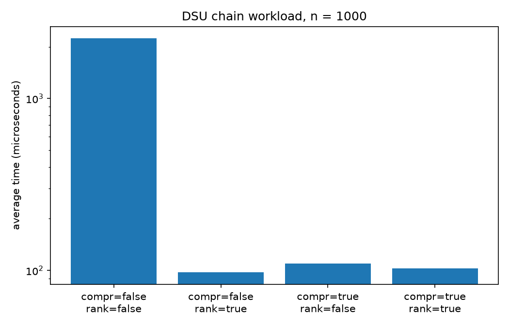
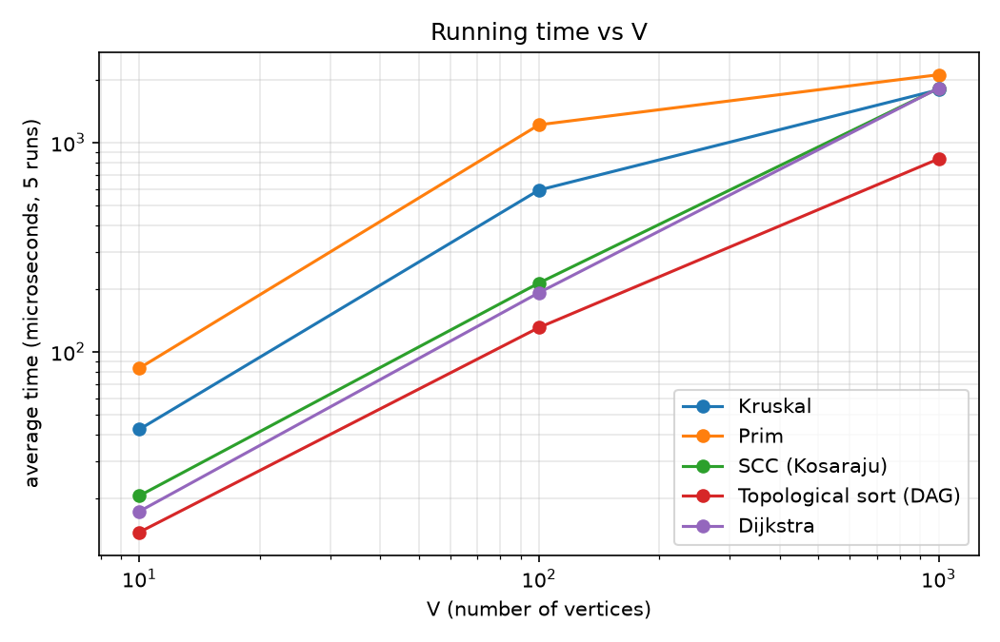
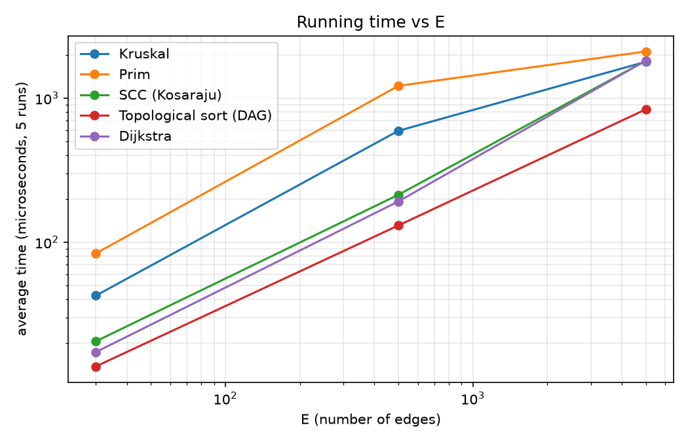

# Assignment 3 — Smart City Infrastructure and Route Planning

**Author:** Mumina Mukazhan, SE-2530

Java application that models a city as a graph: minimum spanning trees (Kruskal, Prim), connectivity (topological sort, SCC) and shortest paths (Dijkstra). Sections: [1 Overview](#1-overview) · [2 Implementation](#2-implementation) · [3 Complexity](#3-complexity-analysis) · [4 Setup](#4-experimental-setup) · [5 Results](#5-results) · [6 Discussion](#6-comparison-and-discussion) · [7 Testing](#7-testing) · [8 Conclusion](#8-conclusion)

---

## 1. Overview

The city is a graph: **vertex** = district, **edge** = road or infrastructure link, **weight** = construction cost (Task 1) or travel time (Task 3), always a non-negative integer.

* **Task 1 (MST):** cheapest network connecting all districts — Kruskal + DSU, Prim + priority queue.
* **Task 2 (connectivity):** build order of dependent projects (Kahn's topological sort) and mutually reachable districts over one-way streets (Kosaraju SCC).
* **Task 3 (shortest paths):** travel time and route from one district to all others — Dijkstra.

**Representation.** `graph.Graph` keeps an **adjacency list** (for walking neighbours) and an **edge list** (for Kruskal's sort, generators, tests). An undirected edge is stored once in the edge list and twice in the adjacency list; a directed edge once in both. Graphs are **simple**: self-loops throw an exception, duplicate edges are ignored (`addEdge` returns `false`, O(1) check with a hash set). Vertices are `0 .. V-1`, weights are `int`.

```
assignment-3/
├── src/  graph/ dsu/ mst/ connectivity/ shortestpath/ benchmark/  Main.java
├── tests/AllTests.java        test runner without external libraries
├── scripts/plot_results.py    reads CSV tables, writes plots
├── results/  tables/ plots/
└── README.md
```

**Build and run** (JDK 21/25, no external Java libraries; plots need Python 3 + matplotlib; run from the project root):

```bash
rm -rf out && mkdir out
javac -d out $(find src -name "*.java") && javac -cp out -d out tests/AllTests.java
java -cp out AllTests              # prints "All 5984 checks passed."
java -cp out Main                  # demo on a named city graph
java -cp out benchmark.Benchmark   # writes results/tables/*.csv
pip3 install matplotlib && python3 scripts/plot_results.py   # writes results/plots/*.png
```

---

## 2. Implementation

* **DSU (`dsu.DisjointSet`).** Arrays `parent[]`, `rank[]`; path compression and union by rank can be switched on/off to measure their effect. `find` walks to the root (and re-points the path to it); `union` attaches the shallower root below the deeper one and returns `false` if both are already in one set (Kruskal's cycle test). It counts finds, unions and **parent steps** (a direct measure of tree depth).
* **Kruskal.** Sort a copy of the edge list by weight (comparator calls counted), call `union` on each edge in order, stop at `V-1` chosen edges, so often fewer than `E` edges are examined.
* **Prim.** Lazy version with `PriorityQueue<Edge>`: visiting a vertex pushes its edges to unvisited neighbours; the cheapest is polled and skipped if its endpoint is already visited. Each edge is pushed once, so the heap holds at most `E` entries.
* **Disconnected graphs (design decision).** Both MST algorithms return a **minimum spanning forest** with `connected = false` instead of failing (Kruskal: the DSU never reaches one set; Prim: restarts from every unvisited vertex). `MstResult` holds `totalWeight`, `edges`, `connected`, `components`.
* **Topological sort (Kahn).** Count in-degrees, queue vertices with in-degree 0, pop, append to the order, decrease neighbours' in-degrees. If fewer than `V` vertices were placed, **a cycle exists**; then `getOrder()` returns an **empty list** (never a partial order) and `getBlockedVertices()` lists the unplaced vertices.
* **SCC (Kosaraju).** DFS recording finishing times, build the reversed graph (`Graph.reversed()`), DFS on it in reverse finishing order; each DFS tree is one component. The DFS is recursive for readability (depth up to `V`, fine for ≤ 1 000 vertices).
* **Dijkstra.** Lazy `PriorityQueue` (Java has no decrease-key): a shorter route pushes a new entry, stale entries are skipped. `parent[]` gives paths via `getPath(target)`. Unreachable vertices keep `UNREACHABLE = Long.MAX_VALUE`, an empty path and no parent; additions happen only for settled vertices, so no overflow. Negative weights are rejected up front with an `IllegalArgumentException`; weight 0 is allowed.
* **Counters.** Every algorithm returns deterministic counters: `edges_examined` (Kruskal: edges taken before stopping; Prim: adjacency entries scanned, `2E`; topological sort: `E` + out-edges of placed vertices; SCC: `2E`, reversed-graph construction timed but not counted; Dijkstra: out-edges of reachable vertices), `comparisons` (comparator calls), `dsu_finds`/`dsu_unions`, `heap_pushes`/`heap_polls`, `relaxations`.

#### Why Dijkstra fails with negative edge weights

Dijkstra settles the closest unsettled vertex and declares its distance **final**. This is valid only because any other route must pass through vertices at least as far away, and extra edges never shorten a route. A negative edge breaks this. Example: `0→1 (4)`, `0→2 (5)`, `2→1 (−3)`, `1→3 (1)`. Dijkstra settles vertex 1 with distance 4 before reaching vertex 2, never revisits it after seeing `2→1 (−3)`, and computes vertex 3 from the wrong value (result 4 and 5). The real distances are 2 (`0→2→1`) and 3 (`0→2→1→3`); Bellman-Ford, which relaxes all edges repeatedly, gives the correct `[0, 2, 5, 3]` (checked in the tests). For negative weights without negative cycles, use Bellman-Ford.

---

## 3. Complexity Analysis

**Assumptions:** adjacency-list graph; `PriorityQueue` is a binary heap (O(log n) insert/remove-min, no decrease-key); `α` = inverse Ackermann (≤ 4 in practice); for connected graphs `E ≥ V−1` and `log E = O(log V)`.

| Algorithm | Time | Extra space | What drives the cost |
|---|---|---|---|
| DSU, both optimizations | O(α(n)) amortized per op | O(n) | almost constant |
| DSU, path compression only / rank only | O(log n) amortized / worst case | O(n) | tree height ≤ log n |
| DSU, no optimization | O(n) per `find` | O(n) | a chain of unions gives height n |
| Kruskal | O(E log E) = O(E log V) | O(V + E) | the sort; DSU part is O(E α(V)) |
| Prim (lazy heap) | O(E log E) = O(E log V) | O(V + E) | ≤ E heap entries, each pushed and polled once |
| Topological sort (Kahn) | O(V + E) | O(V) + graph | each vertex queued once, each edge removed once |
| SCC (Kosaraju) | O(V + E) | O(V + E) | two DFS passes; reversed graph is a full copy; recursion up to O(V) |
| Dijkstra (lazy heap) | O((V + E) log V) | O(V + E) | ≤ E+1 pushes, each O(log V); negative-weight check is one O(E) pass |

* **DSU.** Without optimizations `union(0,1), union(1,2), …` builds a chain and all `find`s walk `n(n−1)/2` steps; path compression flattens paths, rank keeps height ≤ `log n`; together amortized O(α(n)).
* **Kruskal and Prim** have the same bound, driven mainly by `E` (dense graphs: O(V² log V)). In practice Kruskal sorts once and may stop early, Prim does heap work for every edge; for dense graphs an array-based Prim (O(V²)) would be better (not implemented).
* **Topological sort and SCC** are linear in `V + E` and read each edge a constant number of times. **Dijkstra** depends on `E` (relaxations, pushes) and `log V` (heap depth); lazy deletion never exceeds `E+1` heap entries.
* **Space.** All need O(V + E) with the graph; extras are O(V) arrays, an O(E) sorted copy (Kruskal), O(E) reversed graph (Kosaraju), O(E) heap (Prim, Dijkstra). Memory was not measured experimentally.

---

## 4. Experimental Setup

* **Sizes:** Small V=10, E=30; Medium V=100, E=500; Large V=1 000, E=5 000 (E = 3V, 5V, 5V).
* **Seed and weights:** `graph.GraphGenerator` with **fixed seed 42** (`java.util.Random`); weights are random integers 1–100; all graphs are simple.
* **Generators:**
  * `connectedUndirected` (Kruskal, Prim): random spanning tree (each shuffled vertex joins a random earlier one) plus random edges up to `E`; **always connected**, has undirected cycles.
  * `randomDirected` (SCC, Dijkstra, one topological input): random distinct ordered pairs until `E` edges exist; **contains cycles** (SCC finds components of size 8, 99, 986). Dijkstra uses **source 0**.
  * `directedAcyclic` (DAG input): chain over a hidden shuffled order plus random forward edges; **acyclic by construction**.
  * `directedWithOneCycle` (cyclic input): DAG with `E−1` edges plus one back edge last→first, closing a cycle through **all** vertices.
* **Timing:** `System.nanoTime()` **around the algorithm call only** (SCC includes building the reversed graph). Per experiment: one untimed counter run, one untimed JIT warm-up, then **5 timed runs**; reported time is the **average in µs**. Results are stored in a `volatile` field so the JIT cannot discard the work.
* **DSU workload:** worst-case chain `union(0,1), …, union(n−2,n−1)` then `find(i)` for all `i`, for all four optimization combinations, `n = 100` and `1000`; `parent_steps` = total parent pointers followed.
* **Machine:** macOS, OpenJDK 25.0.1, run from IntelliJ IDEA.

---

## 5. Results

Numbers come from `results/tables/*.csv`; times are averages of 5 runs in µs.

### 5.1 Kruskal vs Prim (`mst_comparison.csv`, connected undirected graphs)

| V | E | Time K / P (µs) | MST weight | Edges examined K / P | Comparisons K / P | Prim heap pushes = polls | Kruskal finds / unions |
|---:|---:|---:|---:|---:|---:|---:|---:|
| 10 | 30 | 42.6 / 83.5 | 163 | 9 / 60 | 110 / 208 | 30 | 18 / 9 |
| 100 | 500 | 592.8 / 1215.5 | 1186 | 192 / 1000 | 3826 / 7780 | 500 | 384 / 192 |
| 1000 | 5000 | 1787.5 / 2109.4 | 12086 | 2810 / 10000 | 50488 / 111332 | 5000 | 5620 / 2810 |

All graphs were connected (`connected = true`) and both algorithms gave the same weight.

### 5.2 DSU optimizations (`dsu_optimizations.csv`, chain workload)

| Path compression | Union by rank | n=100 steps | n=100 time (µs) | n=1000 steps | n=1000 time (µs) |
|:---:|:---:|---:|---:|---:|---:|
| false | false | 4950 | 33.1 | 499500 | 2245.0 |
| false | true | 197 | 10.4 | 1997 | 97.4 |
| true | false | 197 | 12.1 | 1997 | 110.0 |
| true | true | 197 | 10.7 | 1997 | 102.7 |



### 5.3 SCC (`scc.csv`, `randomDirected`)

| V | E | Time (µs) | Components | Largest | Edges examined |
|---:|---:|---:|---:|---:|---:|
| 10 | 30 | 20.5 | 3 | 8 | 60 |
| 100 | 500 | 213.1 | 2 | 99 | 1000 |
| 1000 | 5000 | 1816.0 | 15 | 986 | 10000 |

### 5.4 Topological sort (`topological_sort.csv`)

| V | E | Input | Time (µs) | Is DAG | Blocked | Edges examined |
|---:|---:|---|---:|:---:|---:|---:|
| 10 | 30 | dag | 13.7 | true | 0 | 60 |
| 10 | 30 | one_cycle | 3.9 | false | 10 | 30 |
| 10 | 30 | random_directed | 7.7 | false | 8 | 37 |
| 100 | 500 | dag | 130.5 | true | 0 | 1000 |
| 100 | 500 | one_cycle | 43.7 | false | 100 | 500 |
| 100 | 500 | random_directed | 43.0 | false | 100 | 500 |
| 1000 | 5000 | dag | 835.4 | true | 0 | 10000 |
| 1000 | 5000 | one_cycle | 134.9 | false | 1000 | 5000 |
| 1000 | 5000 | random_directed | 103.3 | false | 996 | 5020 |

For every cyclic input the returned order is empty (length 0); Kahn actually placed `V − blocked` vertices.

### 5.5 Dijkstra (`dijkstra.csv`, `randomDirected`, source 0)

| V | E | Time (µs) | Reachable | Edges examined | Relaxations | Heap pushes = polls | Comparisons |
|---:|---:|---:|---:|---:|---:|---:|---:|
| 10 | 30 | 17.3 | 8 | 23 | 9 | 10 | 23 |
| 100 | 500 | 191.6 | 100 | 500 | 152 | 153 | 1594 |
| 1000 | 5000 | 1819.4 | 996 | 4980 | 1462 | 1463 | 24582 |

### 5.6 Plots and demo

Both axes are logarithmic (Kruskal, Prim, SCC, Dijkstra, topological sort on the DAG).





Since `E` grows with `V` (3V, 5V, 5V), the two plots have the same shape and cannot separate the effect of `V` from `E`; this follows from the prescribed configurations.

`java -cp out Main` runs all tasks on an 8-district city (excerpt):

```
Kruskal: total cost 34, connected = true   |   Prim: total cost 34, connected = true
Topological order: [Center, Station, Market, Airport, Park, Harbor, University, Hospital]
After adding Hospital -> Center: no cycle = false (all 8 districts blocked)
SCC groups: [Center, Market, Station] [Airport] [Harbor] [Park, University] [Hospital]
Center -> Hospital: 18 min, path [Center, Park, University, Hospital]
```

---

## 6. Comparison and Discussion

**Kruskal vs Prim.** Both gave the same weights (163, 1186, 12086). Counters are exact: Kruskal examined only 9/30, 192/500 and 2 810/5 000 edges (it stops at `V−1` chosen edges) while Prim always examines `2E`, i.e. 6.7×, 5.2×, 3.6× more. Kruskal's sort needed 110, 3 826, 50 488 comparisons (close to `E·ln E` = 102, 3 107, 42 586); Prim's heap needed about twice as many. Prim pushed and polled each edge exactly once; Kruskal's DSU work is small (finds = 2 × unions). Kruskal was also faster in time at all sizes, but by only ~18 % at `V = 1000` from one graph and 5 runs, so this is a tendency, not a precise ratio.

**DSU.** Without optimization the chain costs exactly `n(n−1)/2` parent steps (4 950; 499 500); with path compression, union by rank, or both only about `2n` (197; 1 997): 25× and 250× fewer, a gap that grows with `n` (quadratic vs linear). Time drops 20–23× at `n = 1000` (2245 → 97–110 µs); the three optimized variants are within noise (≤ 17 %). On this chain each optimization alone keeps trees shallow, so both together add nothing here; in general they complement each other (both: O(α(n)) amortized, one alone: O(log n)).

**SCC.** Time grew ×10.4 and ×8.5 while `V + E` grew ×15 and ×10, so runtime is roughly proportional to `V + E`; the smaller first factor comes from fixed costs (objects, reversed graph, JIT, timer granularity). The counter is exactly `2E`. The random directed graphs have one **giant component** (8, 99, 986 vertices) plus small ones, since average out-degree is 3–5.

**Topological sort.** On DAGs all vertices are ordered with exactly `2E` examined edges (time ×9.5, ×6.4 for `V + E` ×15, ×10). With one back edge every vertex has an incoming edge, the queue starts empty and Kahn stops after the in-degree pass (exactly `E` edges, all `V` blocked); this follows from how the test graph is built, not from cycles in general. Random directed graphs have a few in-degree-0 vertices (2, 0, 4), so 37, 500, 5 020 edges were examined. Cyclic inputs are faster (103–135 µs vs 835 µs at `V = 1000`) only because the algorithm gives up early; the worst case is still O(V + E).

**Dijkstra.** Time grew ×11.1 and ×9.5 while examined edges grew ×21.7 and ×10. Comparator calls (23, 1 594, 24 582) are 1×, 3.2× and 4.9× the examined edges, matching the `log V` factor. Only 10, 153, 1 463 pushes occurred (relaxations + 1), far below `E`. Unreachable vertices (8 of 10, 996 of 1 000 reachable) were handled correctly.

**Theory vs experiment.**

| Algorithm | Predicted | Observed (10 → 100 → 1000) |
|---|---|---|
| Kruskal | E log E | comparisons ×34.8, ×13.2 (E·ln E: ×30.5, ×13.7); time ×13.9, ×3.0 |
| Prim | E log E | comparisons ×37.4, ×14.3; time ×14.6, ×1.7 |
| SCC | V + E | edges ×16.7, ×10; time ×10.4, ×8.5 |
| Topological sort (DAG) | V + E | edges ×16.7, ×10; time ×9.5, ×6.4 |
| Dijkstra | E log V | edges ×21.7, ×10; comparisons ×69, ×15; time ×11.1, ×9.5 |

Operation counts match the theory closely; times only roughly. At `V = 1000` the DAG topological sort was fastest (835 µs) while SCC, Dijkstra, Kruskal and Prim all fell in 1 788–2 109 µs, so times do not clearly separate O(V + E) from O(E log V) at this size; the `log` factor shows in the comparator counts. SCC takes about twice as long as the topological sort despite the same `2E` counter because of uncounted work (reversed graph, second pass, recursion).

**Limitations.**
* MST timings are the least reliable: Kruskal and Prim grow only ×3.0 and ×1.7 from `V = 100` to `1000` (counters ×13–14). A likely, unverified cause is that the MST experiment runs first in the JVM with the least JIT warm-up, so that comparison rests mainly on counters.
* One graph per size (seed 42) and 5 runs; microsecond timings are noisy and machine-dependent, counters are not.
* `V` and `E` are not varied independently; Dijkstra used only source 0; Kosaraju's DFS is recursive; memory was analyzed theoretically only.

---

## 7. Testing

`tests/AllTests.java` uses no external library; `check(condition, message)` throws an `AssertionError` (the `assert` keyword is not used since it needs `-ea`). A successful run prints `All 5984 checks passed.`

| Required case | Where it is tested |
|---|---|
| Small graphs | hand-made graphs with known answers: 5-vertex MST (weight 11), 8-vertex SCC, 7-vertex Dijkstra |
| Disconnected graphs | MST on 3 components (forest weight 8, `connected = false`) and 30 random sparse graphs; Dijkstra on a disconnected graph |
| Graphs with cycles | cycle 1↔2 and a 3-cycle; generated one-back-edge graphs on all sizes and seeds |
| Multiple valid MSTs | 4-cycle with equal weights: both algorithms return a valid tree of the same weight |
| Unreachable vertices | `UNREACHABLE`, empty path, no parent; source without out-edges; random graphs |
| Duplicate edge weights | complete graph K4, all weights 7 (MST weight 21) |
| Single vertex | MST, topological sort, SCC and Dijkstra |

| Correctness check | How it is verified |
|---|---|
| Kruskal weight = Prim weight | connected random graphs of all sizes, 5 seeds; on disconnected graphs also forest weight and component count |
| Every MST is valid | real edges, no cycle, weights sum to the total, connects exactly what the graph connects |
| Valid topological order for every DAG | each vertex once, every edge forward; small and generated DAGs, 4 seeds per size |
| Cyclic graphs detected | `isDag() == false`, empty order, correct blocked vertices; cross-checked with SCC |
| Every vertex in exactly one SCC | lists contain each vertex once and `getComponentOf` agrees |
| SCC correctness | 30 random graphs: same component exactly when mutually reachable (independent BFS) |
| Dijkstra distances | vs independent **Bellman-Ford**: all sizes, 5 seeds, directed and undirected, 2 sources; paths use real edges and sum to the distance |
| Negative weights | Dijkstra throws `IllegalArgumentException`; Bellman-Ford gives `[0, 2, 5, 3]` on the Section 2 example |

Also tested: input validation (self-loops, out-of-range vertices, 0 vertices, wrong graph direction), generator properties (size, connectivity, weights 1–100, same/different seed), DSU counters and chains, and exact counter values.

**Testing the tests.** 12 bugs were injected one at a time (Dijkstra polling the farthest vertex, no parents, accepting negative weights, not skipping stale entries; wrong Kosaraju order; backward edges in the DAG generator; Kruskal sorting descending; Prim dropping edges; Kahn never lowering in-degrees; no path compression; duplicate edges accepted; Kruskal never reporting disconnection). Every version made the tests fail.

---

## 8. Conclusion

* **MST.** Identical weights everywhere; Kruskal was faster (sorts once, stops after `V−1` edges, examining 30–56 % of edges, about half Prim's comparisons). It suits sparse graphs given as an edge list and spanning forests; Prim suits adjacency structures and, with an array instead of a heap, dense graphs.
* **DSU.** Essential: parent steps fell from `n(n−1)/2` to about `2n` (499 500 → 1 997) and time about 20×; both optimizations give the O(α(n)) guarantee.
* **Connectivity.** Kahn and Kosaraju both run in O(V + E). Kahn orders a DAG and detects cycles (fewer than `V` placed), the right tool for dependency ordering; Kosaraju finds groups of mutually reachable districts.
* **Shortest paths.** Dijkstra with a binary heap is O((V + E) log V) and handles unreachable vertices; it needs non-negative weights, otherwise use Bellman-Ford.
* **Method.** Counters agree closely with theory; times only roughly because of small sizes, JIT warm-up and the joint growth of `V` and `E` (see the MST caveat in Section 6).
